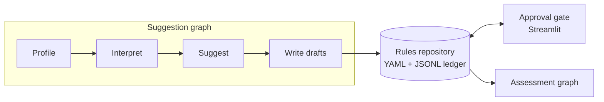
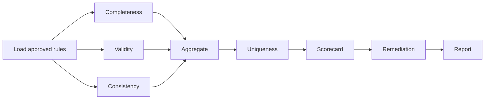

# AgentDQ: agentic data quality for SAP material master data

AgentDQ assesses the data quality of SAP material master data in the tables MARA, MARC and MAKT. Agents profile the data and suggest data quality rules. A person approves each rule. A deterministic executor then runs the approved rules, and agents judge uncertain duplicates and write a remediation plan.

AgentDQ is a proof of concept and a portfolio piece. It is not a product. It runs on an open-source stack against synthetic data and SAP Cloud Appliance Library (CAL) sandbox extracts.

## What it does

The agentic value is in rule suggestion. Rule execution stays deterministic. AgentDQ uses a language model only where a task needs judgement:

| Step | Who does the work | Model call |
|---|---|---|
| Profile each table | Deterministic profiler (pandas) | No |
| Interpret the profile | Profiling agent (DSPy) | Yes |
| Suggest rules from the rule bank and the profile | Rule suggestion agent (DSPy) | Yes |
| Approve, edit or reject each suggestion | A person, at the approval gate | No |
| Run the approved rules | Pandas executor, through the Completeness, Validity and Consistency agents | No |
| Find duplicate materials | Uniqueness agent: fuzzy score, semantic score, attribute veto | No |
| Judge uncertain duplicate pairs | Adjudicator (DSPy), capped number of calls | Yes |
| Group, rank and explain fixes | Remediation agent: deterministic ranking, model narrative | Narrative only |

Each suggestion carries a rationale, the evidence from the profile, and a confidence. The confidence is arithmetic with visible parts, not a number that the model invents.

The rule bank holds 106 rule templates, built from an SAP Information Steward rules workbook. The suggestion agent uses them as a starting point. They are not the active ruleset.

## Data quality dimensions

AgentDQ covers four of the six DAMA data quality dimensions.

| Dimension | Status | Method |
|---|---|---|
| Completeness | Built | Not-null rules, from approved suggestions |
| Validity | Built | Domain rules: each value must be in its list of permitted values |
| Consistency | Built | Cross-field rules, for example the MRP type against the lot size |
| Uniqueness | Built | Blocking on MTART and MEINS, fuzzy and semantic scores on MAKTX, attribute veto, then model adjudication |
| Timeliness | Not built | A useful staleness check needs the change history (CDHDR and CDPOS). The current extracts do not include it. |
| Accuracy | Not built | Accuracy needs an outside source of truth, for example a supplier catalogue. The project has none. |

## Architecture

AgentDQ uses two LangGraph graphs. The rules repository joins them. The pause for human approval is the repository, not a LangGraph `interrupt()`. A suggestion can wait days for approval, and no graph run stays open during that time.





The three rule-based checks run in parallel. Their findings go to the Uniqueness stage as structured advisories. For example, a record with an invalid description stays out of duplicate matching.

## Technology

| Component | Technology |
|---|---|
| Orchestration | LangGraph, two `StateGraph` graphs |
| Model calls | DSPy signatures, default model `openai/gpt-4o-mini` |
| Rule execution | pandas |
| Duplicate scoring | rapidfuzz (`token_sort_ratio`) and sentence-transformers (`all-MiniLM-L6-v2`) |
| Rule storage | YAML files and a JSONL audit ledger |
| User interface | Three Streamlit apps |
| Tests | pytest, offline, with fake models |
| Environment | Python 3.14 and uv |

## Get started

### Prerequisites

- Python 3.14
- [uv](https://docs.astral.sh/uv/)
- An OpenAI API key, only for the runners that call a model

### Install

```bash
git clone https://github.com/Lookieman/agentdq.git
cd agentdq
uv sync
cp .env.example .env
```

If you use the runners that call a model, put your key in `.env`. To use a different model, change `AGENTDQ_MODEL`, or give the `--model` flag.

### Run the tests

```bash
uv run pytest -q
```

The suite has 282 tests. All tests run offline. One test is skipped because it needs the real CAL extracts in `data/raw/`.

### Make the synthetic data

The CAL extracts are not in the repository. The table profiles from those extracts are in `data/profiles/`, so you can make the synthetic data without the extracts.

The full chain has four steps. Run them in this order, because each step reads the output of the step before it. Step 1 needs the extracts in `data/raw/`. The outputs of steps 1 and 2 are committed in `data/profiles/` and `config/rules/`, so without the extracts, start at step 3.

1. Profile the extracts:

   ```bash
   uv run python -m src.data.profiler --input data/raw --tables MARA,MARC,MAKT \
       --pattern "{table}_EX_DATA.xlsx" --out data/profiles
   ```

2. Import the Information Steward rules:

   ```bash
   uv run python -m src.rules.is_importer --workbook docs/Infomation_Steward_Rules_Tables.xlsx \
       --schema config/schema --tables MARA,MARC,MAKT --out config/rules
   ```

3. Make the clean baseline:

   ```bash
   uv run python -m src.data.generator --schema config/schema --profiles data/profiles \
       --tables MARA,MARC,MAKT --materials 5000 --seed 42 --out data/synthetic/baseline
   ```

4. Inject labelled defects:

   ```bash
   uv run python -m src.data.defect_injector --baseline data/synthetic/baseline \
       --schema config/schema --rules config/rules --scenario degraded \
       --seed 42 --out data/synthetic/degraded
   ```

`config/rules/cross_field_examples.yaml` is written by hand and committed. The importer in step 2 does not make it. Step 4 reads every rule file in `--rules`, so the file must sit beside the imported rules. Without it the degraded set has no Consistency defects: 9,232 labels instead of 10,596.

The scenarios are `healthy`, `degraded` and `critical`. Each defect is labelled with its table, record, field and dimension. The injector labels a defect only after the executor finds it, so the ground truth agrees with the executor.

### Run an assessment

```bash
uv run python -m tools.run_assessment_graph --data data/synthetic/degraded \
    --format parquet --rules config/rules
```

The default rules folder is `data/approved/`, which holds only the rules that a person approved. The approval gate rewrites it after every decision. It is committed, with the five MARA rules approved so far. The `--rules config/rules` flag runs all imported rules instead.

If no vector file exists, the Uniqueness agent uses the fuzzy score only. The console shows the mode in use.

### Open the apps

```bash
uv run streamlit run app/dashboard.py
uv run streamlit run app/gate.py
uv run streamlit run app/bank_browser.py
```

| App | Purpose |
|---|---|
| `app/dashboard.py` | Scorecard, findings, duplicates, ranked actions, evidence and settings |
| `app/gate.py` | Approve, edit or reject suggestions, and write manual rules |
| `app/bank_browser.py` | Browse the rule bank and govern rule strength |

### Run the model and vector steps

These runners call a paid model or download a model. Each runner shows its flags with `--help`.

| Runner | Purpose |
|---|---|
| `tools.run_suggestion` | Profile, interpret and suggest rules for one table |
| `tools.build_embeddings` | Build the semantic vectors for duplicate matching (downloads the embedding model) |
| `tools.run_adjudication` | Judge the uncertain duplicate pairs (`--cap` sets the maximum calls, default 500) |
| `tools.run_remediation` | Write the remediation narrative |

Each runner writes its result to a file beside the dataset or in `artefacts/`. The apps read these files, so the apps make no model calls.

## Project structure

```text
agentdq/
+-- app/               Streamlit apps: dashboard, approval gate, rule bank browser
+-- artefacts/         Suggestion and remediation outputs
+-- config/
|   +-- reference/     Reference-table manifest
|   +-- rule_bank/     Rule templates and field roles
|   +-- rules/         Rules imported from Information Steward, plus cross-field examples
|   +-- schema/        One YAML contract for each SAP table
+-- data/
|   +-- approved/      Approved rules, exported by the approval gate
|   +-- profiles/      Table profiles from the CAL extracts
|   +-- repository/    Rule candidates and the audit ledger
+-- docs/              Design, project plan and module map
+-- src/
|   +-- agents/        Dimension agents, uniqueness, adjudicator, remediation
|   +-- data/          Extract loader, profiler, generator, defect injector
|   +-- dspy_modules/  DSPy signatures and model configuration
|   +-- reporting/     Scorecard, assessment and evaluation
|   +-- rules/         Rule IR, importer, rule bank, repository, executor
|   +-- orchestrator.py, graph_nodes.py, state.py, contracts.py
+-- tests/             Offline pytest suite
+-- tools/             Command-line runners
```

## Add a new SAP table

`tools/onboard_object.py` reads an SE16N or SE12 extract and writes a draft schema for a new table, for example EQUI. It finds the header row and the candidate key, and it maps fields to known roles. It does not use a model. A person must review the draft before the table joins the assessment.

## Status and limits

- Packages 1 to 4 are built: data foundation, approval gate, LangGraph orchestration, and uniqueness with remediation. The close-out of Package 4 is in progress.
- Planned packages: evaluation with MLflow (Package 5), a local model on a Mac mini (Package 6) and a public demo (Package 7).
- The confidence weights and the retrieval thresholds are placeholders. Package 5 calibrates them.
- The duplicate settings in `config/schema/mara.yaml` are tuned on synthetic data only.
- Only material master data is in scope. Equipment master data is a candidate for the onboarding tool, and is not built.

## Documentation

- [Design](docs/agentdq_design.md)
- [Project plan](docs/agentdq-project-plan.md)
- [Module map](docs/modules_map.md)

Articles about the design decisions:

1. [Where should intelligence live in a data quality system?](https://www.linkedin.com/pulse/where-should-intelligence-live-data-quality-system-luqman-ali-x3rhe/)
2. [Can an agent decide what your data quality rules should be?](https://www.linkedin.com/pulse/can-agent-decide-what-your-data-quality-rules-should-luqman-ali-et8je/)

## Licence

Apache License 2.0. See [LICENSE](LICENSE).

## Author

[Luqman Ali](https://github.com/Lookieman)
